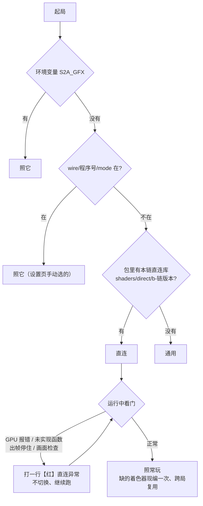

# 通用 + 直连双轨：设计稿（直连线，10-24）

> **已被 方案_快速通用模式.md 取代（10-25 全面切换）**：现行流程是「首次启动即直连、通用模式只作兜底」，不再有「通用起手 → 收集 → 提示重启切直连」这一步。以下为 10-24 的历史设计，保留不删，不再按它施工。

方案定稿：维护者 10-24「好的开始做吧」，见 https://claude.ai/artifact/HxJYz7puyANp2TwSfhBdGq 。维护者 10-24 审过提纲，五条意见已并入（§1.3、§4.2、§5.2、§3.3、§8）。
施工手册：nvn-wire skill（~/.claude/skills/nvn-wire）。前序试点：docs/研究/AI接线_C档_丝之歌.md。

> **10-25 改版（维护者 拍板「直连起手、通用兜底」，开发计划 方案_快速通用模式.md WP9）**：包里带本宿主翻译链的直连库就首次启动即直连，不再「通用起手 → 收集 → 提示重启切直连」；直连崩溃或画面异常写 `fail`，下次起局退回通用并告知。收集（§4）保留，改作给离线库 / 社区缓存补漏的数据来源，不再是切换前提。现行判定见 §1.1，旧的 §4.4、§11.1、§11.2 只作历史。

> 10-24：直连的实现形态（继续 NVN → IRenderer，还是接入上游直连链图形部分）见 [设计_直连架构.md](设计_直连架构.md)；本文 §3「直连共用通用模式的着色器」以那份 M0 功耗读数后的结论为准。

## 0. 一句话

同一个包里有两个画面入口：**通用**（游戏自带 NVN 驱动 → Ryujinx.Graphics.Gpu 模拟 → IRenderer → graphics/metal，现状）和**直连**（游戏的 NVN 调用 → graphics/wire 前端 → 同一个 IRenderer → graphics/metal）。游戏代码执行、Ryujinx 系统服务、存档、着色器缓存、苹果图形层两边共用。~~手机上先用通用模式玩、边玩边收集，就绪后提示重启切直连~~（10-25 起：包里有直连库就首次启动即直连）；直连出错或画面异常，下次启动自动退回通用。

实测依据（10-24，测试设备2，01006F8002326000同场景 16:9 30 帧）：上游直连链 1.89 W（3 局中位）/ S2Arm 通用 2.67 W（1 局）；直连原型目标是向 1.89 W 靠拢。

## 1. 启动时选入口

### 1.1 判定（原生层 runtime/src/gfxmode.c `decide`，装载重定位时一次，结果只读）
10-26 现行（维护者改定：运行中不切换，旧的 `fail` 起局删掉、不作依据），从高到低，第一条成立即定：

| 序 | 条件 | 结果 |
|---|---|---|
| 1 | 环境变量 `S2A_GFX=direct / generic`（开发局、执行器） | 照它 |
| 2 | `Documents/wire/<程序号>/mode`（设置页手动选的 `direct` / `generic`） | 照它 |
| 3 | **包里带本宿主翻译链的直连库**：`<游戏数据>/shaders/direct/b-<DMSH_CHAIN>/`，且链进了直连图形层（`s2a_direct_packaged`） | **直连**（直连起手） |
| 4 | 其余（没出直连库的包、链版本对不上） | 通用 |

- 链版本对不上就不算有库：老包换新宿主时不会带着旧库直连、满屏现编。
- 判定结果写 host.log 一行「图形模式：直连 / 通用（依据 …）」。
- Mac 测试局的游戏数据就是产物根：根里出了本链的直连库后，不写 `S2A_GFX` 的局会走直连；要跑通用模式的局显式写 `S2A_GFX=generic`。

> 旧表（10-24，`runtime/src/wire.c` 设想：`S2A_WIRE`、`off`、`running`、适配档 `direct=on`、就绪标记 `ready`）未按此实现，作废。

### 1.2 两个入口在进程里的分界
- 直连：装载器把游戏导入的 `nvnBootstrapLoader` 解析到 wire.c；游戏按名字取的全部 NVN 函数给 C# 前端的实现或报红桩（现状，wire/silksong-c）。RenderLoop 改调 `Wire.RunRender`（Ryujinx GPU 上下文照建、闲置）。
- 通用：游戏照常用 sdk 里自带的 NVN 驱动。§4 的收集需要时，在 `nvnBootstrapLoader` 上套一层计数转发（只计名字，转发到 sdk 的真实现）。

### 1.3 铁律例外（维护者意见 1）
通用模式下接管 `nvnBootstrapLoader`（哪怕只是计数转发）属于「按函数名拦 SDK」，是 **维护者 10-24 批准的双轨例外**，范围只限这一个入口；直连模式整体接管 NVN 同属此例外。两者都**缺省关**：没有适配档、没有就绪标记、没开收集时，装载器、渲染循环、服务层的行为与现在逐字节相同（单测 runtime/tests/t_wire.c 核「关时恒走原路径」）。docs/方案.md 铁律节同步注明。

## 2. NVN 函数覆盖表

- 全集 = 上游 dm/gfx/nvn/names.txt 的 536 个名字（游戏可能按名字取址的全部 NVN 函数；小菠萝为 523）。表：`docs/直连_NVN覆盖表.tsv`，生成：`graphics/wire/tools/nvn_coverage.py <上游直连链根> <输出> 款=<产物根> …`。
- 列：上游直连链实现（语义 / 空 / 红）、S2Arm graphics/wire（已做 / 未做 / 原生）、各款字符串表里有没有（上界）。
- 10-24 首版读数：上游直连链语义 399 + 空 14；S2Arm 已做 300；01006F8002326000可能用到 534，S2Arm 未做而上游直连链有实现的 124 个 → 原型前补齐（进行中）。差异项（S2Arm 与上游直连链语义不同的 25 处）逐条见 references/nvn_semantics.md「S2Arm 差异」，补函数时逐条判断。
- 「用到」的真值来自手机端收集（§4），字符串表只是上界：Unity / 引擎常把指针整批拷进自己的表，静态计数不可信（丝之歌实测）。

## 3. 着色器共用

### 3.1 现状（丝之歌实测）
直连不翻译着色器：按客体代码从包内通用模式的 Ryujinx 磁盘缓存（shcache）取同一份宿主程序（`S2ALazyProgram.Materialize` / `LoadProgramBinary`），同一套绑定（Ryujinx ShaderProgramInfo → GAL binding；NVN 槽号：用户常量 c[3+r]、分离贴图 / 采样器句柄 c[2][0x168+8r] / c[2][0x568+8r]、存储缓冲 c[0][基址+0x10r]），Metal 离线库照样命中。丝之歌 Mac 直连局命中 21、未命中 0。
（对照：上游直连链用另一套翻译规则，与 S2Arm 9629 对着色器 0 相同，不能共用——见对比报告。）

### 3.2 特化变体按 NVN 状态选
同一客体代码在缓存里可有多份特化（Ryujinx GpuAccessor 回答不同）。直连在绘制时按当前 NVN 状态选：
- 透明测试开 / 关：ColorState 透明测试函数 ≠ ALWAYS（已做，`WireShaders.Variant`）。
- 贴图目标 / 格式、顶点属性类型、深度模式 / 原点：逐个核对缓存条目的特化状态与当前绑定；不符时报红并计数（原型阶段先计数看分布，再决定是否按状态挑）。

### 3.3 计算着色器读取口径（维护者意见 4）
包内 shcache 的计算程序按「跳过 0x100 字节头」烘，通用路径运行时带头读，两边起点不同（离线核：运行时真值缓存 95 个程序里只中 44，没中的 51 个全是计算程序）。定：**改出包一侧与运行时一致**，由画面·着色器线改（10-24 已发需求）；过渡期直连两种口径都试、分别计数（`ComputeHeaderSkipHits`），新包上该计数应为 0。

## 4. 手机端收集（10-25 起只作补漏数据来源，不是切换前提）

### 4.1 收什么
| 项 | 来源（通用模式下） | 用途 |
|---|---|---|
| NVN 函数调用集 | `nvnBootstrapLoader` / `nvnDeviceGetProcAddress` 计数转发桩：每个名字一支静态桩，首次**调用**置位一个字节后跳到 sdk 的真实现 | 就绪判据：调用集 ⊆ 直连已实现集 |
| 着色器 / 管线 | 通用路径现有：Ryujinx 磁盘缓存（运行中只追加）、管线使用清单 pso_use | 就绪判据：直连要的程序都在缓存里 |
| 行为信号 | §6 乙类键的观测点（写跟踪、条件渲染、计数器读回等） | 写入 `signals.tsv`，切直连时作适配档的运行时部分 |

### 4.2 计数转发桩的开销与正确性（维护者意见 2）
- iOS 不能现生成代码：536 支桩在 wire.c 里**静态编好**（与报红桩同一种宏展开），每支 = 读一个字节、未置位则置位（只第一次）、尾跳真实现；稳态多一次加载 + 一次分支。
- **必须按调用计，不按取址计**：游戏常在启动时一次性按名字取全表（丝之歌 main 535 个名字全取、静态读出在用的只有 225 个下界）。桩只在被调用时置位。
- 量：通用模式下「开收集 / 关收集」同包 A/B（tools/ab.sh），比帧率与功耗；差异超过噪声底（01006F8002326000 0.10 W）就改成只在前 N 分钟收集，之后桩改走直跳（换函数指针表里的目标）。

### 4.2a NVN 调用集能不能在出包时静态得到（维护者 10-24 评估项）
不能，如实记：游戏启动时一次性把所有名字都取址。证据：
- 上游直连链01006F8002326000真机局（10-24 n2）日志：启动阶段 nvnDeviceGetProcAddress 调了 1068 次（≈ 字符串表 534 个名字各取两遍），而启动期间真正被调用的只有 180 个函数；
- 01006F8002326000字符串表 534 个名字里有 122 个上游直连链根本没实现（调到会报红），游戏照样跑通；
- 丝之歌 main 535 个名字全取址，静态读出在用的只有 225 个（下界，也不准）。
所以「扫取址用的函数名字符串」得到的超集 = 全集，判不出实际调用集。出包时能静态给的只有上界（覆盖表「用到」列）；要么直连把超集全部实现（含上游直连链也没实现的 122 个），要么按手机端实际调用收集（§4.2）。原型取后者。

### 4.3 存在哪
`Documents/wire/<程序号>/`：`calls.tsv`（名字、首次调用帧号）、`signals.tsv`、`ready`（就绪标记，内容 = 包指纹）、`running` / `fail`（§5）、`log.tsv`（每次判定 / 切换 / 退回一行）。全部本地，不联网。

### 4.4 就绪判据（全部满足才写 ready）——10-25 作废：直连起手不等就绪
1. 调用集 ⊆ 直连已实现集（App 内嵌一份已实现名单，与 WireTable 同源生成）；
2. 着色器 / 管线：**出包时即可判满足**（维护者 10-24，维护者 提）——直连直接从包内通用模式的 Ryujinx 缓存取程序，包里带了社区着色器缓存（Ryujinx 格式，含客体原码与特化状态；10-23 起九款都带，社区数据合计约 +191 MB）的游戏，这一项在出包时就已就绪，不必等手机收集；出包时把「包内缓存覆盖的客体代码集」写进包。手机端只需再收集 NVN 函数调用集与行为开关；直连局里若仍遇到包内缓存没有的程序（社区数据没覆盖到的），按通用路径同样的首遇规则阻塞现编并记录，计入下一次就绪判断；
3. 连续 N 分钟游玩没有新增调用名字（N 原型期 10 分钟，看数据调）；
4. 适配档里本款没有标「丙类必需」的缺项。
就绪后界面提示「高性能模式已就绪，重启生效」；用户不点就一直通用。

## 5. 自动退回

### 5.1 机制
- 直连起局写 `running`；正常收局，或稳定出图满 M 分钟（原型 5 分钟），就清掉它。
- 三种失败写 `fail`（含原因、帧号）并退出：
  - 崩溃：s2a_crash_install 的处理里写；
  - GPU 报错：graphics/metal 命令缓冲错误回调；
  - 卡死：见 5.2。
- 下次启动见 `running` 或 `fail` → 通用，并提示（§1.1 第 3 条）。设置页「重试高性能模式」删掉 `fail`；「始终用通用模式」写 `off`。

### 5.2 卡死判定（维护者意见 3）
不写死「10 秒不出图」。判定 = **不出图 且 游戏线程没有进展**（原生层已有游戏线程进度计数：svc / 让步 / 等待计数在窗口内不变）；阈值按这款在通用模式下实测的最长加载时长 × 2 取，收集期顺带记下（`signals.tsv` 的 max_load_ms），没有读数时取 60 秒保守值。

## 6. 行为开关的运行时判定

上游直连链适配档 36 个键的分类（10-24 分析报告）：

| 类 | 键 | 判法 |
|---|---|---|
| 甲：静态读游戏文件就能定 | 身份与打包类、modules、romfs_marker、mem_reserve / mem_stack（非虚拟内存游戏）、mem_used、tex_dyn_slots、game_env 等 | 出包时自动 |
| 乙：运行时观察能自动判断 | tex_flush_upload / tex_dirty_upload（CPU 在贴图被 GPU 用过之后还写它的页：S2Arm 写跟踪可见）、render_cond（条件渲染至少一次判为不画）、gpu_timestamps（一帧 ≥2 次时间戳上报且被 CPU 读回）、feedback_snap（通道内采样自己的颜色附件）、vconv_range、mem_map_limit、mem_alias / app_pool（虚拟内存游戏）、pad_layout（记玩家选择） | 通用模式下观测、写 signals.tsv |
| 丙：只能人工 | fps_target / fps_hold / present_interval（60 帧）、core_preempt、op_mode / perf_mode、alpha_from_red | 进适配档，出包时带上 |

S2Arm 的直连只实现我们自己的对应机制，键名可以照搬，语义按 S2Arm 结构重写；不搬上游直连链的按函数名 HLE 与写死地址的补丁。

## 7. 存档共用的前提

两种模式共用同一套 Ryujinx 系统服务与存档布局（与上游直连链不同：上游直连链01006F8002326000的设备存档在 Documents/save，S2Arm 在 Ryujinx 布局里），存档里没有图形状态，所以切换不需要转换。前提：直连不改任何服务层行为；直连局里服务层收到的请求序列与通用局在存档相关的部分一致（原型时用存档哈希核，§8）。

## 8. 01006F8002326000原型（第一款）

| 判据 | 怎么量 |
|---|---|
| Mac 上直连到 MARK | wirerun.sh 01006F8002326000 … route；近况行 绘制 > 0、跳过 0、报红 0 |
| 着色器命中（带社区数据的包） | 直连局近况行：着色器缓存 命中 / 未命中各多少；未命中 = 0 为过 |
| 与通用模式同存档逐帧对拍画面一致 | 真值局 = 通用模式同根同存档；tests/visual/wire_cmp.py 块指标 + 单调对齐，新增红行 0 |
| 测试设备2 同包功耗向 1.89 W 靠拢 | tools/ab.sh 01006F8002326000 S2A_WIRE=01006F8002326000，AccumulatedSystemLoad 口径，≥3 局中位，16:9（S2A_SCREEN_W=1920）与宽屏各一组 |
| 通用模式不退 | 同包关直连的健康表六格与现行一致 |
| 存档双向切换（意见 5） | 通用 → 直连 → 通用各进一次岛、存一次档，三次都能读回 |
| 退回不写坏存档（意见 5） | 直连局中途强杀 / 注入 GPU 错误触发退回：退回前后存档目录逐文件哈希只增不坏（同名文件要么不变、要么能被游戏读回） |
| 缺省关一致 | native-test-wire + 通用层原有门禁全绿 |

第一个可测节点：01006F8002326000 Mac 直连起局不崩，近况行、报红桩清单、与通用模式存帧比对的第一份差异图。

## 9. 合入与默认关

一律缺省关：没有 `S2A_WIRE`、没有适配档 `direct=on`、没有就绪标记时，行为与现在完全一样。合入走 rebase → 整套门禁 → train.sh enqueue。

## 10. 第三方说明

直连前端的 NVN 语义参照上游直连链（MIT，© seedds，源自我们的 d2r-mobile）的 dm/gfx/nvn/hle_nvn.c、nvn_mtl.m、nvn_obj.h、nvn_tex.c 与适配档键名；未拷贝代码段。合入前在 docs/第三方说明（或现有致谢处）写明参照了哪些文件，并保留上游直连链 LICENSE 全文。

## 11. 切换无感（维护者 10-24 批，原型阶段先写设计、不挡01006F8002326000第一个节点）

### 11.1 挑时机提示（10-25 作废：不再提示切直连；只在退回通用时告知）
- 就绪后不马上提示，等到下列任一时刻：
  - **刚存过档**：服务层看到这款的存档文件系统 Commit（Ryujinx `IFileSystem.Commit`，挂在存档数据上的那个），之后 30 秒内且没有新的写入；
  - **回到标题**：没有可靠的通用判法，不作为必需条件；有适配档标注标题页特征的款才用。
- 提示语「刚存过档，现在切换不会丢进度」。
- 就绪后最多等 15 分钟；等不到存档时机，就改为普通提示「高性能模式已就绪，下次启动生效」（不催重启）。
- 判定逻辑在服务层（Commit 计数 + 时间戳），提示交给前端。阈值进 `signals.tsv`，看实测再调。

### 11.2 切换前预热（10-25 作废：首次直连局的首遇现编靠离线库覆盖与跨局复用压低）
- 提示之前在后台把直连会用到的管线编好：两种模式共用着色器，管线清单 pso_use 也共用；后台线程按清单预建，复用通用路径现有的预热机制。
- 编完才弹提示。
- 验收：第一次直连局首遇现编 = 0（近况行的现编计数）。

### 11.3 快速失败、立刻回来（10-26 维护者改定：运行中不切换）
- **10-26 改定**：下列情况不再判整局失败。出错只在出错那一处兜底（跳过或补上），按原因类别各打一行 `【红】直连异常（不切换，继续跑）：<原因>`（同一类每局一次，`graphics/nvn/host_adapt.m s2a_direct_fail`），直连继续跑；不写 `fail`、不弹窗、不收局。看门照常检测、照常打红行（开发局 `tools/dev_run.sh` 按红行判红），出帧停住的现场转储（`runtime/src/ap_host.c`，每局至多 3 次）照旧。崩溃就是崩溃，`crash.c` 不再写 `fail`。玩家机上旧的 `fail` 起局时删掉、打一行，不作依据（`runtime/src/gfxmode.c`）。下面是原「判失败」的条目，现为打红行的条目：
  - 未实现函数被调用（报红桩被调到）；
  - GPU 报错（命令缓冲错误回调）；
  - 不出图且游戏线程无进展（§5.2）；
  - 画面检查（10-25）：游戏的绘制被持续丢掉——最近 10 秒里 ≥ 8 秒有「缺功能丢弃」（宿主缺这个功能、明知扔了游戏要画的东西），或「出错丢弃」（建不成管线、pass 起不来）占当秒绘制 ≥ 20%。不按像素判黑屏（加载、淡入淡出、过场长时间黑会误退）。判据 `graphics/nvn/host/pic_watch.inc`，单测 `graphics/nvn/tests/t_pic_watch.c`。
- ~~回到通用模式后提示「已切回通用模式」~~（10-26 删：不再退回，提示、确认弹窗与退回原因文案一并删掉）。
- 存档逐文件哈希只增不坏（§8 验收）。

### 11.4 试用期
- 前 N 次直连启动（原型 N = 3）标为试用：设置页显示「高性能模式（试用中）」，随时一键切回。
- 连续 N 次正常收局（没有写过 `fail`）才转为默认；试用期内任何一次失败都退回通用，并清零计数。
- 状态记在 `Documents/wire/<程序号>/trial`（剩余次数）。

### 11.5 统一的「请求重启到某模式」入口
- **10-26 维护者改定**：没有运行中的「退回」了；兼容（通用）路线改成出包时按款定（包里带不带直连库），运行中不再切换。下面「退回」与「直连失败时等存档、提示重新打开」两条作废，入口只剩设置页手动切换（写 `mode`）。
- 切换（通用 → 直连）、退回（直连 → 通用）、设置页手动切换，三者走同一个入口：`s2a_mode_request(mode, reason)`。它的工作：写好下次启动的选择（`ready` / `off` / `fail`），然后执行「重启」。
- **当前行为（维护者 10-24 定）**：
  - 切换时只写入目标模式；
  - 直连失败时，先等存档落盘（等服务层存档 Commit 完成，最多 5 秒），再提示玩家「请重新打开游戏」；
  - 下次启动按写入的模式起。
- **升级路径**：原生层线评估过进程内重启，能做，约 2–3 天，有第二局残留状态和低区泄漏的风险（docs/研究/进程内重启评估.md）。先不做，等直连原型证明真机收益后再立项；做的时候只替换这个入口里的「重启」一步，其余逻辑不变。

## 12. 直连补充包：后台拉取（维护者 10-24 提，原型阶段只写设计、不实现，不挡01006F8002326000节点）
目的：一款游戏在我们这边已经验证过直连（自己测试设备上收集、对拍过），玩家手机就不必再从零收集（§4）——启动时后台拉一份「补充包」，拿到后走现有的切换流程（§11）开启高性能模式。

### 12.1 流程
1. 每次启动，若 `Documents/wire/<程序号>/ready` 不存在、且设置页没关「自动获取」，就起一个后台请求，和游戏启动并行，**不挡进游戏**。
2. 超时短：连接 3 秒、整体 10 秒；每次启动只试一次，不在本局内重试。
3. 结果三种：
   - 服务器上没有（404）：照常玩，什么都不提示；
   - 没网 / 超时 / 出错：静默，下次启动再试；
   - 有：下载到临时文件 → 验签（§12.4）→ 校验索引三元组与本机一致 → 原子改名放到 `Documents/wire/<程序号>/pack/`，写 `ready`（内容 = 包指纹 + 「来源：补充包」）。
4. 之后完全复用 §11：等下一次存档提交（§11.1）提示「刚存过档，重启即可开启高性能模式」；切换走 `s2a_mode_request`（§11.5）；前 N 次是试用期（§11.4）；直连失败就退回通用（§5、§11.3）。
5. `log.tsv` 每次拉取记一行（时间、结果：没有 / 失败原因 / 下载并验过）。

### 12.2 补充包里有什么（只有数据）
| 项 | 用途 | 对应本地文件 |
|---|---|---|
| 就绪标记 | 判定「这款可以直连」，含我们验证时的 App 构建指纹 | `ready` |
| 行为开关 | §6 乙类键的取值（条件渲染、写跟踪等） | `signals.tsv` |
| 预热清单 | 切换前后台预建管线（§11.2） | pso_use 同格式 |
| 按版本的适配数据 | 该程序版本的适配档条目 | 适配档同格式 |
- **不含任何代码**：iOS 不能运行下载来的代码。包里只有固定格式的表，由 App 内置代码解析；格式严格校验，不认识的键忽略并记一行，解析失败整包丢弃。
- **不含游戏内容**：不带着色器、贴图、存档，也不带任何从游戏文件里抽出来的东西（着色器缓存已经在包内，§4.4）。
- 大小上限 1 MB，超了直接丢弃。

### 12.3 索引
- 路径 = `<程序号>/<程序版本>/<我方 App 版本>/pack`。三者任一不同就当「没有」：
  - 程序版本不同，NVN 调用集、适配数据都可能变；
  - App 版本不同，直连已实现的函数集合（WireTable）会变。
- 程序版本取装载时读到的版本号（NACP 版本 + main 的构建号）；App 版本取构建号。
- 请求只带路径里这三样，不带设备标识、账号、存档或任何个人数据。

### 12.4 签名
- 用我方私钥签名（Ed25519，签整包字节）。私钥离线保存，只在出补充包的机器上用。
- App 内置公钥，**先验签再解析**；验不过就丢弃并记一行，不重试本局。
- App 内置两把公钥（当前 + 下一把），换钥时不用等所有人升级。
- 传输用 HTTPS；签名保证内容，HTTPS 只防窃听。

### 12.5 国行「无线数据」提示与设置
- 国行手机上，App 第一次联网时系统会弹「允许"S2Arm"使用无线数据？」（无线局域网与蜂窝网络 / 仅无线局域网 / 关闭）。它只弹一次，弹出时游戏照常在后面跑。
- 处理方式：
  - 选「关闭」：拉取一直失败（静默），这款继续走本地收集（§4），不影响游戏；
  - 想改：系统「设置 → 无线数据」里改，或 App 设置页提示文字指过去。
- 使用说明里写明：App 联网只做这一件事，拉的是高性能模式的配置数据，不上传任何东西。
- 设置页加开关「自动获取高性能模式数据」，缺省开。关掉后完全不发请求，系统提示也就不会被这件事触发。
- 首次请求是否要等进游戏后若干秒再发（避开启动画面上弹系统提示）：原型期先看真机效果再定。

### 12.6 与本地收集的关系
- 补充包和本地收集（§4）是就绪的两个来源，满足任一即可；补充包来的就绪同样走试用期，没有特权。
- 拿到补充包后本地收集照开：直连局里出现补充包没覆盖的 NVN 调用（报红桩被调到），按 §11.3 立刻判失败、退回通用，并把这款的补充包标为「本机不适用」，之后不再用它，回到本地收集。

### 12.7 服务器形态（选项，留 维护者 定）
| 方案 | 优点 | 代价 / 风险 |
|---|---|---|
| A. GitHub（Releases / 仓库静态文件） | 免费，和现有仓库流程一体 | 国内访问不稳，国行用户可能大面积超时 |
| B. Cloudflare R2 / Pages | 免费额度够，自带全球 CDN | 国内访问一般，偶发慢 |
| C. 国内对象存储 + CDN（阿里云 OSS / 腾讯云 COS） | 国内稳定、快 | 小额费用；自定义域名要 ICP 备案 |
| D. 自建服务器 | 完全可控 | 要运维，单点故障 |
- 也可以组合：国内源优先，失败再试海外源（每次启动仍只试一轮，总时长仍受 12.1 的超时约束）。
- 这几种都只是静态文件托管，App 侧代码一样，换源只改 URL 常量。

### 12.8 验收（实现时）
- 断网、DNS 失败、404、超时、签名错、索引不符、超大包、格式坏，各一例：游戏启动耗时与不拉取时相同（差在噪声内），都不提示、不崩，`log.tsv` 各记一行原因。
- 正常一例：拉到 → 存档后提示 → 重启进直连 → 试用期计数正确。
